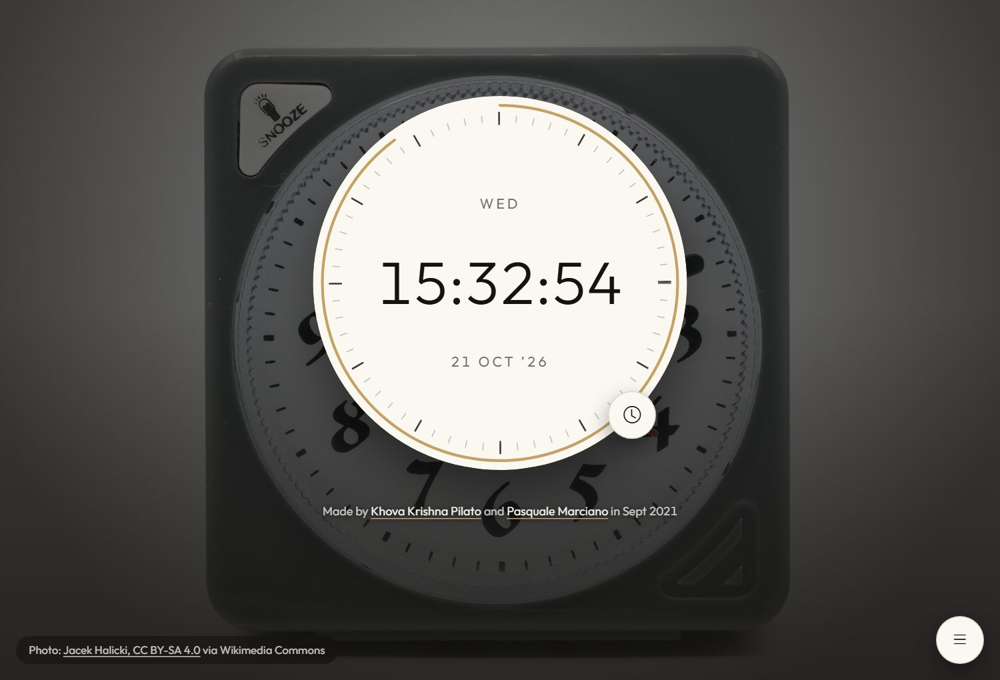
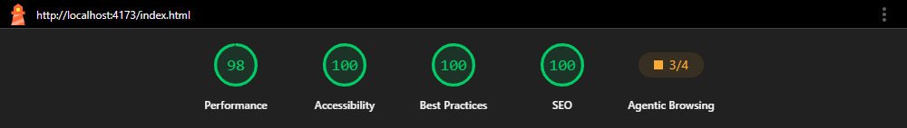
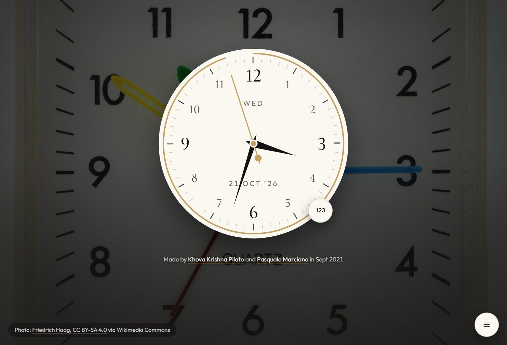
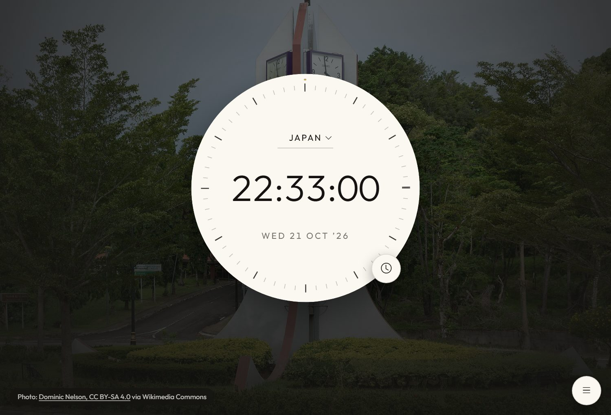
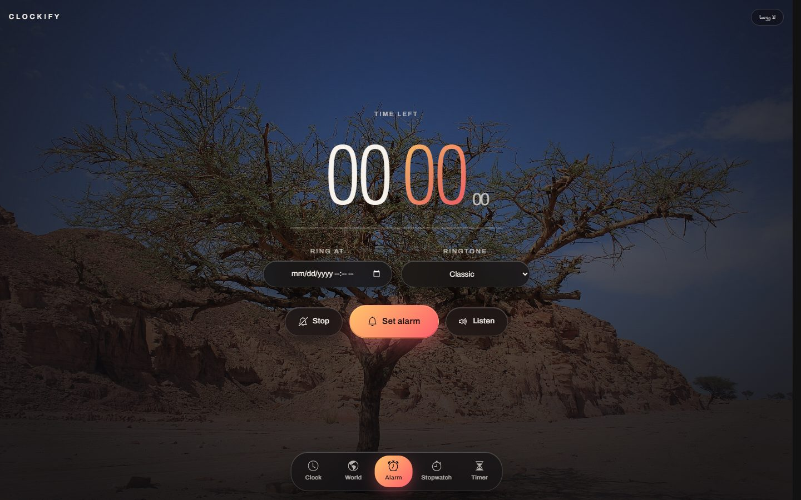
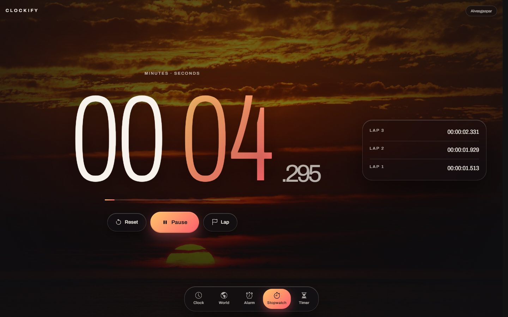
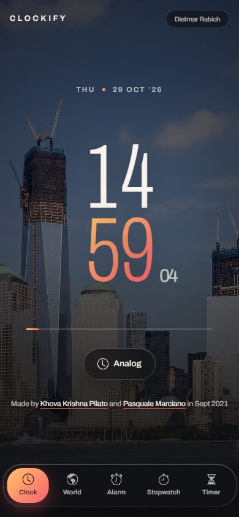
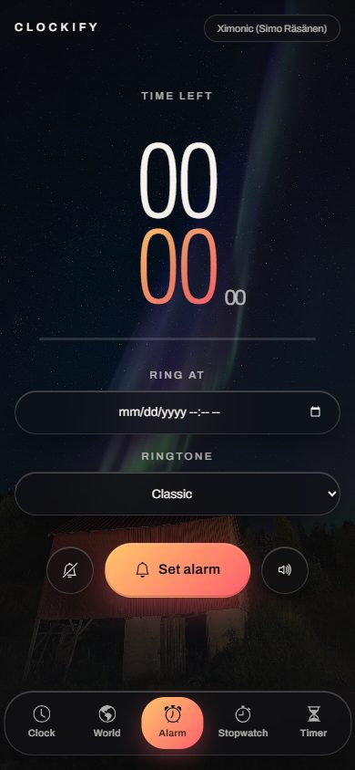

# Clockify

Clockify is a simple and elegant clock with world clocks, an alarm, a stopwatch and a countdown.

**Live: [krishnapilato.github.io/clockify](https://krishnapilato.github.io/clockify/)**



This project started during our internship: we were a team of two and made the first version in two days, in Sept 2021. We keep improving it step by step.

Made by [Khova Krishna Pilato](https://www.linkedin.com/in/khovakrishnapilato) and [Pasquale Marciano](https://www.linkedin.com/in/pasquale-marciano-443a55205/).

---

## Lighthouse



Measured with Lighthouse 13.6 on the production build (`npm run build && npm run preview`):

| Page      | Performance (mobile / desktop) | Accessibility | Best Practices | SEO |
| --------- | :----------------------------: | :-----------: | :------------: | :-: |
| Clock     |            98 / 98             |      100      |      100       | 100 |
| World     |            100 / 96            |      100      |      100       | 100 |
| Alarm     |            98 / 96             |      100      |      100       | 100 |
| Stopwatch |            99 / 97             |      100      |      100       | 100 |
| Countdown |            99 / 96             |      100      |      100       | 100 |

---

## The Design

The redesign is based on the oversized-numbers clock shots on Dribbble (like the _World Clock App_ concepts), with a warm amber-to-coral accent:

- **Huge condensed numbers** fill the screen: hours above minutes on phones, side by side on wide screens. The seconds sit small next to them.
- A **thin gradient line** under the numbers shows the progress of the minute, the alarm or the countdown.
- **Pill buttons with a label** (Reset · Start · Lap), with the main action in the gradient.
- A **floating glass dock** at the bottom to move between the five pages.
- A **random free photo** in the background on every visit: landscapes, mountains, sea, aurora, skylines, bridges… darkened so the numbers are always readable. Only the author is shown in the top-right corner, with a link to the photo and its license.
- **Fully responsive**: phones, tablets, desktops, and phones in landscape.

| Analog                            | World clocks                     |
| --------------------------------- | -------------------------------- |
|  |  |

| Alarm                           | Stopwatch with laps                     |
| ------------------------------- | --------------------------------------- |
|  |  |

 

---

## Features

1. **Clock** (`index.html`): the time, the day and the date. One button switches between the digital and the analog clock.
2. **World clocks** (`clocks.html`): choose one of 53 countries from the pill above the numbers.
3. **Alarm** (`alarm.html`): pick the date, the time and one of six ringtones. Keep the page open: the alarm rings only while the page is open.
4. **Stopwatch** (`stopwatch.html`): minutes, seconds and thousandths, with laps.
5. **Countdown** (`countdown.html`): tap the numbers and type the minutes and seconds, up to 99 minutes. The **1 min** button adds a minute, even while it runs.

---

## Privacy First

- No accounts, no tracking, no analytics, no cookies.
- Your choices (clock style, country, ringtone) are **encrypted** with AES-GCM 256 before they are saved in `localStorage`. The key is a non-extractable Web Crypto key kept in IndexedDB, so the raw key can never be read or exported.
- Values read back from storage are checked against a fixed list (ringtones, countries, clock styles) before they are used.
- The photos and the Wikimedia API are loaded **without cookies and without referrer**.
- A strict **Content Security Policy** allows only the site itself and Wikimedia.

---

## Stack

- **Vite 8** multi-page build, **TypeScript 7** (ESNext, strictest options), **SCSS** with the Sass module system
- **GSAP 3** for the animations
- **Bootstrap 6.0.0 alpha 1** (Reboot) and **Bootstrap Icons** (only the 17 icons we use, as SVG masks)
- **Archivo** variable font (width axis for the condensed numbers), self-hosted
- **Wikimedia Commons API** for the photos (free, no key)
- **Node.js ≥ 26.13 LTS**

---

## Quality Gates

Every warning is an error. `npm run check` runs all of them, and GitHub Actions runs it before every deploy: if anything fails, nothing is deployed.

| Command                | What it checks                                                                                                |
| ---------------------- | ------------------------------------------------------------------------------------------------------------- |
| `npm run format:check` | Prettier formatting                                                                                           |
| `npm run typecheck`    | TypeScript 7 strict mode (`noUnused*`, `noUncheckedIndexedAccess`, …)                                         |
| `npm run lint`         | ESLint with `typescript-eslint` strict type-checked and the **SonarJS** (SonarQube) rules, `--max-warnings 0` |
| `npm run lint:styles`  | Stylelint (standard SCSS), `--max-warnings 0`                                                                 |
| `npm run lint:html`    | html-validate                                                                                                 |
| `npm run unused`       | knip: unused files, exports and dependencies                                                                  |
| `npm test`             | Vitest with **100% coverage** on the logic (time, countries, photos, timer)                                   |

The build fails on any Sass or Rolldown warning too, and the workflow runs `npm audit`.

---

## How to Run It

```bash
npm install
```

```bash
npm run dev
```

Other scripts: `npm run build` (production build in `dist/`), `npm run preview` (serve the build), `npm run format` (fix formatting).

---

## Files

| Path                | What is inside                                        |
| ------------------- | ----------------------------------------------------- |
| `*.html`            | One HTML file for every page                          |
| `src/pages/`        | The TypeScript entry of every page                    |
| `src/lib/`          | Shared modules: clock, timer, sound, storage, photos… |
| `src/styles/`       | SCSS partials: tokens, layout, face, controls, icons  |
| `tests/`            | Unit tests                                            |
| `public/`           | App icon, ringtones, `robots.txt`                     |
| `.github/workflows` | Check and deploy to GitHub Pages                      |

---

## Accessibility

- Every control works with the keyboard and the focus is always visible.
- The time has a readable label for screen readers, and the alarm messages are announced.
- On narrow phones the side buttons show only the icon, but keep their name for screen readers.
- With reduced motion turned on, the animations and the parallax are off.

---

## Contact Us

We welcome feedback, suggestions and ideas!
