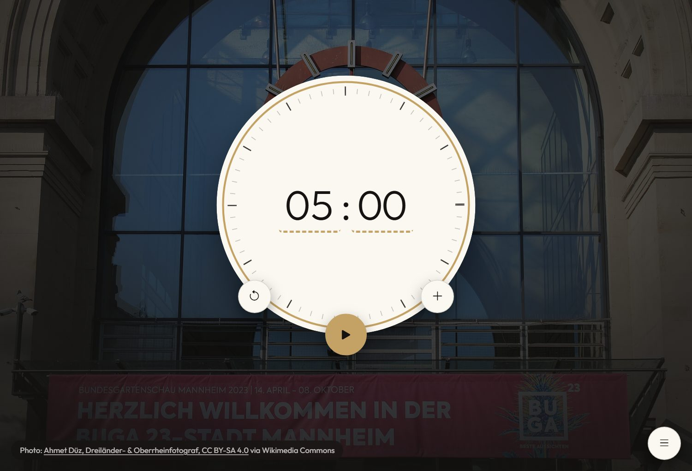
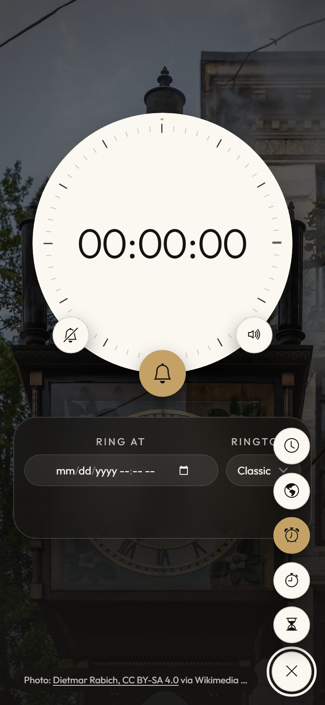

# Clockify

Clockify is a simple and elegant clock app with world clocks, an alarm, a stopwatch and a countdown.

**Live preview: [krishnapilato.github.io/clockify](https://krishnapilato.github.io/clockify/)**

This project is part of our internship experience. We were a team of two and we made the first version in two days. We keep improving it step by step.

Made by [Khova Krishna Pilato](https://www.linkedin.com/in/khovakrishnapilato) and [Pasquale Marciano](https://www.linkedin.com/in/pasquale-marciano-443a55205/) in Sept 2021. Keeping project updated.

---

## Technologies Used

- **HTML5**
- **CSS**
- **JavaScript (ESNext)**: modern syntax like `const`, arrow functions, template literals, `?.` and `??`
- **Bootstrap 6.0.0 alpha 1**
- **Bootstrap Icons 1.13.2**
- **GSAP 3** for the animations
- **Wikimedia Commons API** for the background photos (free, no key needed)

---

## The Look

- Every page is one centered **dial**, and everything you need is inside it or on its edge. Small round buttons sit on the edge of the dial: the gold one in the middle is the main action, the small ones on the sides do the rest.
- Every time you open a page you get a **random photo of a clock** in the background. Phones get a tall photo and computers get a wide one.
- The text is always easy to read: the photo is darkened and the controls sit on frosted glass. With a mouse, the dial tilts a little and the photo moves behind it, so the page has some depth.
- The **menu** is the small round button in the bottom-right corner. Click or tap it and the page icons come out one by one. Click it again, or anywhere else, to close it.

---

## Features Overview

### 1. Clock (`index.html`)

The current time, with the day on top (**WED**) and the date at the bottom (**21 OCT ’26**), all inside the dial. The small button at the bottom right of the dial switches between the digital and the analog clock, and the page remembers your choice.

### 2. World Clocks (`clocks.html`)

- Tap the country name at the top of the dial to choose another one from the list of 53 countries.
- The dial shows the time and the date there.
- For countries with more than one time zone, the time of the main city is used (for example New York for the United States).
- The page remembers the country you chose. The analog style works here too.

### 3. Alarm (`alarm.html`)

- Pick the date and time and the ringtone, side by side under the dial.
- There are six ringtones: **Classic**, **Chime**, **Bells**, **Digital**, **Pulse** and **Sunrise**. The speaker button lets you listen to the one you chose.
- The gold bell sets the alarm and the crossed bell stops it.

Keep the page open: the alarm only rings while the page is open.

### 4. Stopwatch (`stopwatch.html`)

The gold button starts and pauses. The flag saves a lap and the arrow resets everything. It shows **hours, minutes, seconds and thousandths**.

### 5. Countdown (`countdown.html`)

The minutes and seconds inside the dial are the place where you write the time: the dashed gold line under the numbers shows that you can tap them and type. The default is **2 minutes**. The **+** button adds one minute, even while it is running, and the countdown can be up to 99 minutes. When the time is up you hear the ringtone you chose in the alarm page.

### Works on the phone too

 

---

## Background Photos

The photos come from [Wikimedia Commons](https://commons.wikimedia.org/), the free media library of Wikipedia. The page asks for "Quality images" of clocks and picks one at random.

- It is completely free: there is no account, no key and no limit to share, so it works on GitHub Pages.
- Every photo has a free license, so its author and license are written in the bottom-left corner with a link to the photo.
- If the photo cannot load, the page keeps its dark background.
- To change the photos of a page, change `data-photo` on its `<body>` (for example `data-photo="clock tower"`).

---

## Files

| File | What is inside |
| --- | --- |
| `index.html`, `clocks.html`, `alarm.html`, `stopwatch.html`, `countdown.html` | One HTML file for every page |
| `style.css` | The style of all the pages |
| `script.js` | The JavaScript of all the pages, with the functions they share |
| `icon.svg` | The app icon |
| `sounds/` | The six ringtones |
| `screenshots/` | The images of this README |

---

## How to Run It

Open `index.html` in the browser. There is nothing to install, but you need the internet for the fonts, Bootstrap, GSAP and the photos.

Bootstrap 6 needs a recent browser: Chrome or Edge 130, Firefox 132 or Safari 18 and newer.

---

## Accessibility

- Every button works with the keyboard and the focus is always visible. The menu opens with Enter and closes with Escape.
- The buttons with only an icon have a name for screen readers and a tooltip.
- Every page has a title for screen readers, even if it is not shown.
- Screen readers get the messages of the alarm.
- If your device asks for reduced motion, the animations and the 3D tilt are turned off.

---

## Planned Improvements

- Keep the alarm after the page is closed.
- Show a notification when the alarm rings in another tab.
- Let the user upload a ringtone.

---

## Contact Us

We welcome feedback, suggestions and ideas!
