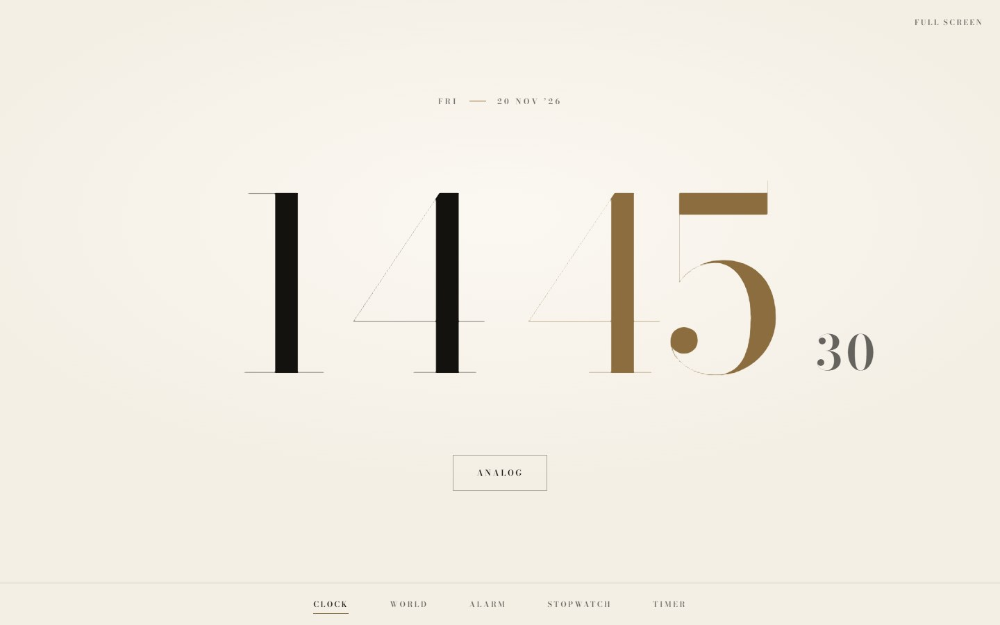
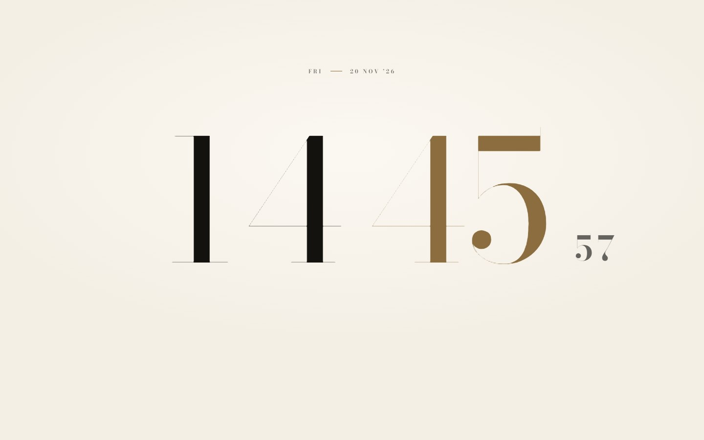
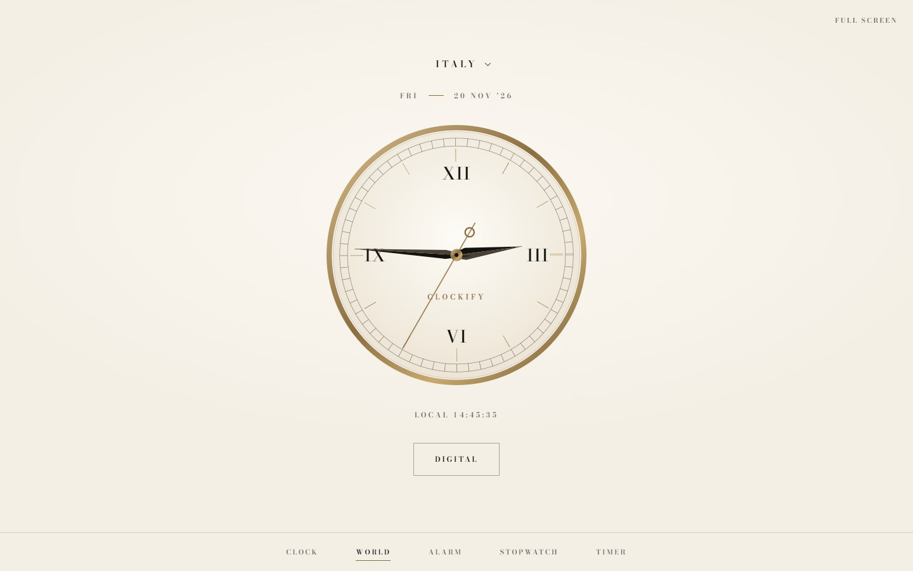
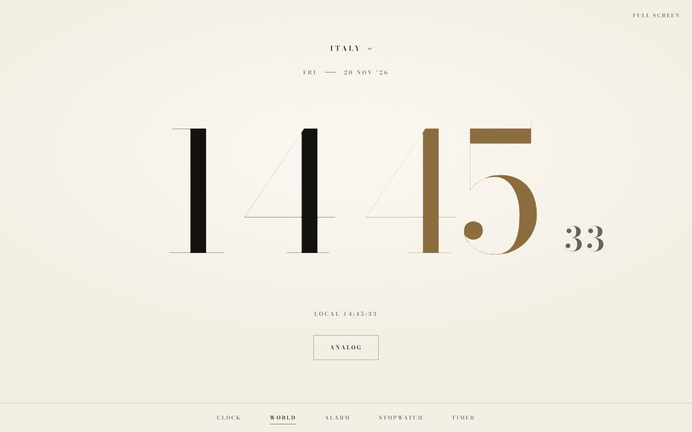
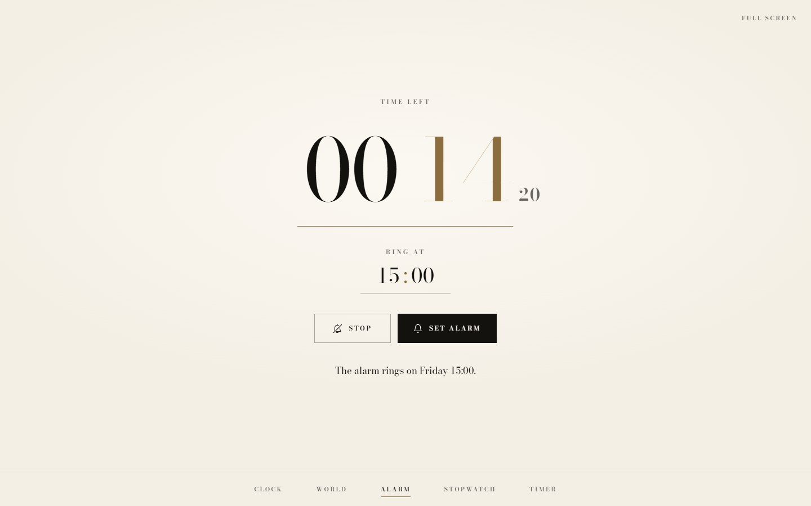
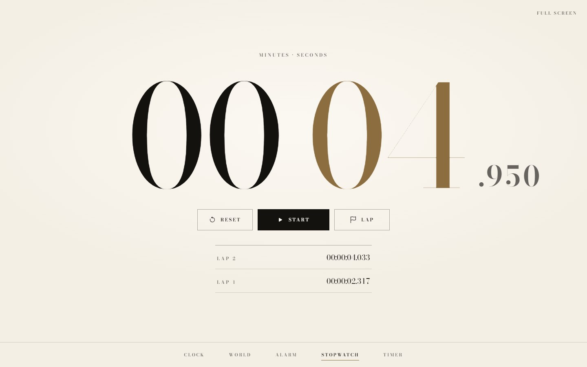
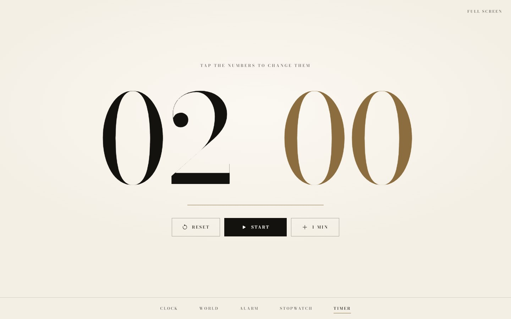

# Clockify

Clockify is an elegant standby clock in the style of Italian fashion: a clock, world clocks, an alarm, a stopwatch and a timer. It is privacy-first and works locally, with no accounts.

**Live: [krishnapilato.github.io/clockify](https://krishnapilato.github.io/clockify/)**



This project started during our internship: we were a team of two and made the first version in two days, in Sept 2021. We keep improving it step by step.

Made by [Khova Krishna Pilato](https://www.linkedin.com/in/khovakrishnapilato) and [Pasquale Marciano](https://www.linkedin.com/in/pasquale-marciano-443a55205/).

---

## A Standby Screen First

Leave Clockify open on a second screen, a tablet or an old phone while you do something else.

- **The screen stays on** (Screen Wake Lock) while the page is visible.
- **Quiet mode:** after 4 seconds without input, the buttons, the navigation and the cursor fade away. Only the time, the date and the dial stay. Move the mouse, tap or press a key to bring them back.
- **Full screen** with the button at the top right, or the <kbd>F</kbd> key.
- **No burn-in:** the clock drifts a few pixels every minute, so an always-on OLED screen does not mark.
- Quiet mode waits while you type, and never hides _Stop_ while an alarm rings.



---

## The Design

The language of Italian fashion and fine watchmaking: ivory paper, ink, and one accent in antique gold.

- **Bodoni numerals**, huge and with hairline strokes: hours above minutes on phones, side by side on wide screens.
- **Labels in spaced small capitals**, like a tailor's label. Hairline rules, square corners, plenty of space.
- **A dress-watch dial**: gold bezel, ivory dial, a minute track, gold batons, Roman numerals and faceted dauphine hands.
- **Tailored controls**: rectangular hairline buttons; only the main action is filled.
- **A quiet bottom bar**; a gold hairline marks the current page.
- **Soft dissolves** between sections (view transitions). There is no loader: every page is ready at once.
- **Fully responsive**: phones, tablets, desktops, and phones in landscape.

| Analog                                 | World clocks                          |
| -------------------------------------- | ------------------------------------- |
|  |  |

| Alarm                                | Stopwatch with laps                          |
| ------------------------------------ | -------------------------------------------- |
|  |  |

| Timer                                    |
| ---------------------------------------- |
|  |

---

## Features

1. **Clock** (`index.html`): the time, the day and the date. One button switches between digital and analog.
2. **World clocks** (`clocks.html`): choose one of 53 countries; your local time stays visible in a smaller label.
3. **Alarm** (`alarm.html`): type a time (24-hour) or use the arrow keys. It rings the next time the clock shows that hour, today or tomorrow, with a soft chime. Keep the page open: the alarm rings only while the page is open.
4. **Stopwatch** (`stopwatch.html`): minutes, seconds and thousandths, with laps.
5. **Timer** (`countdown.html`): tap the numbers and type minutes and seconds, up to 99 minutes. The **1 min** button adds a minute, even while it runs.

---

## Privacy First

- No accounts, no tracking, no analytics, no cookies.
- No third-party content: the font, the icons and the sound are served by the site itself.
- Your choices (clock style, country) are **encrypted** with AES-GCM 256 before they are saved in `localStorage`. The key is a non-extractable Web Crypto key kept in IndexedDB, so the raw key can never be read or exported.
- Values read back from storage are checked against a fixed allowlist before they are used.
- A strict **Content Security Policy** allows only the site itself, with no inline scripts or styles.

---

## Light by Design

Every page is under **60 kB** on first load, font included, and the build fails if anything grows past its budget.

| What                     | Size (gzip)      |
| ------------------------ | ---------------- |
| Shared JavaScript        | 3.6 kB           |
| JavaScript of one page   | 0.1 – 1.1 kB     |
| CSS                      | 5.7 kB           |
| Font (Bodoni Moda Latin) | 46 kB (one file) |
| First load of a page     | about 56 kB      |

No framework and no animation library: motion uses the Web Animations API and CSS view transitions.

---

## Stack

- **Vite 8** multi-page build, **TypeScript 7** (ESNext, strictest options), **SCSS** with the Sass module system
- **Web Animations API** and **cross-document view transitions** for motion
- **Bootstrap Icons** (only the icons we use, as SVG masks)
- **Bodoni Moda** variable font (weight and optical size), self-hosted, Latin subset only
- **Node.js ≥ 26.13 LTS**

---

## Quality Gates

Every warning is an error. `npm run check` runs the checks below, then GitHub Actions builds the site: if anything fails, nothing is deployed.

| Command                | What it checks                                                                                               |
| ---------------------- | ------------------------------------------------------------------------------------------------------------ |
| `npm run format:check` | Prettier formatting                                                                                          |
| `npm run typecheck`    | TypeScript 7 strict mode (`erasableSyntaxOnly`, `noUncheckedIndexedAccess`, `exactOptionalPropertyTypes`, …) |
| `npm run lint`         | ESLint with `typescript-eslint` strict type-checked, SonarJS, and `strict-boolean-expressions`               |
| `npm run lint:styles`  | Stylelint (standard SCSS), `--max-warnings 0`                                                                |
| `npm run lint:html`    | html-validate (recommended + document)                                                                       |
| `npm run unused`       | knip: unused files, exports and dependencies                                                                 |
| `npm test`             | Vitest with **100% coverage** on the logic (time, countries, timer)                                          |
| `npm run size`         | **Size budget** for every file and every page's first load (runs after `npm run build`)                      |

The build fails on any Sass or Rolldown warning too, and the workflow runs `npm audit`.

---

## How to Run It

```bash
npm install
```

```bash
npm run dev
```

Other scripts: `npm run build` (production build in `dist/`, then the size budget), `npm run preview` (serve the build), `npm run format` (fix formatting).

---

## Files

| Path                     | What is inside                                        |
| ------------------------ | ----------------------------------------------------- |
| `*.html`                 | One HTML file for every page                          |
| `src/pages/`             | The TypeScript entry of every page                    |
| `src/lib/`               | Shared modules: clock, timer, sound, standby, motion… |
| `src/styles/`            | SCSS: reset, tokens, layout, face, controls, icons    |
| `tests/`                 | Unit tests                                            |
| `scripts/size-budget.js` | The size budget                                       |
| `public/`                | App icon, ringtone, `robots.txt`                      |
| `docs/screenshots/`      | README images                                         |
| `docs/decisions/`        | Why Clockify is built this way (decision records)     |
| `.github/workflows`      | Check and deploy to GitHub Pages                      |

---

## Decisions

The main choices, and what they cost, are written down in [`docs/decisions`](docs/decisions/README.md): standby first, the Italian fashion design, one typeface, the Web Animations API instead of GSAP, no loader, motion always on, the simple alarm, and the size budgets.

---

## Accessibility

- Every control works with the keyboard and the focus is always visible.
- The time has a readable label for screen readers, and the alarm messages are announced.
- On narrow phones the side buttons show only the icon, but keep their name for screen readers.
- Gold is never used for small text, so the text keeps a readable contrast.
- Motion is slow and small, and it stays on even when the system asks to reduce motion (see [decision 0006](docs/decisions/0006-motion-always-on.md)).

---

## Contact Us

We welcome feedback, suggestions and ideas!
